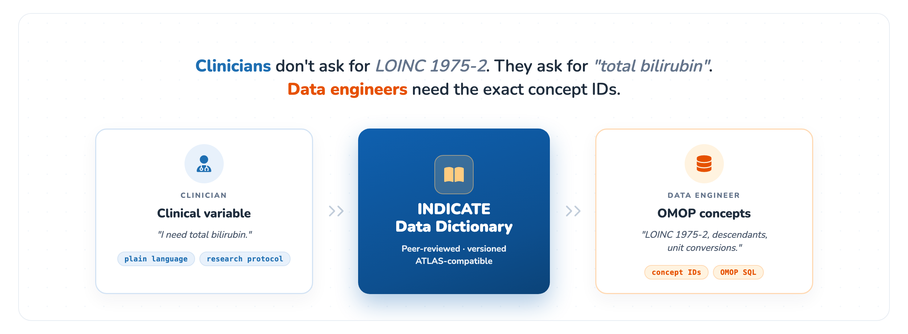
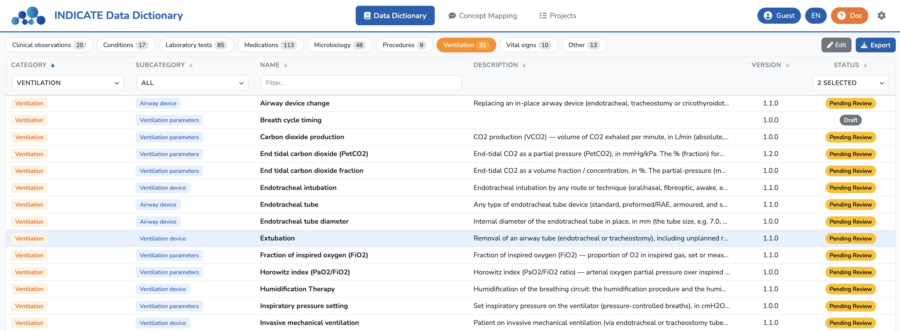
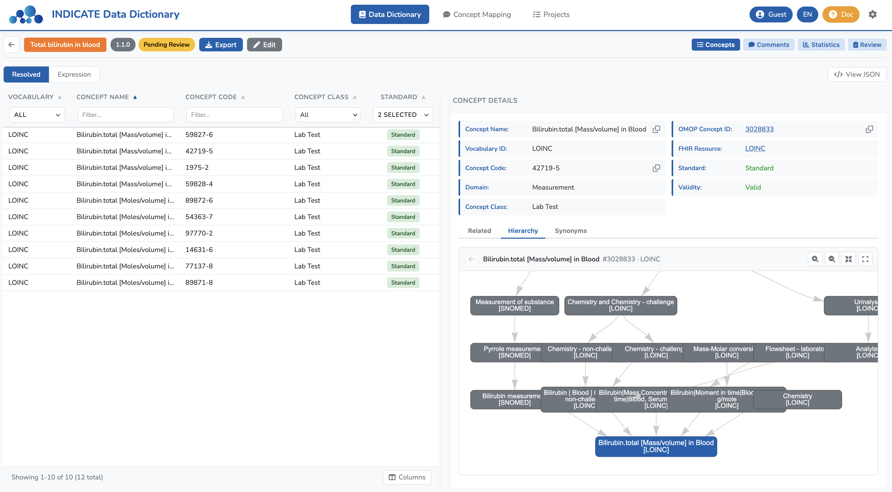
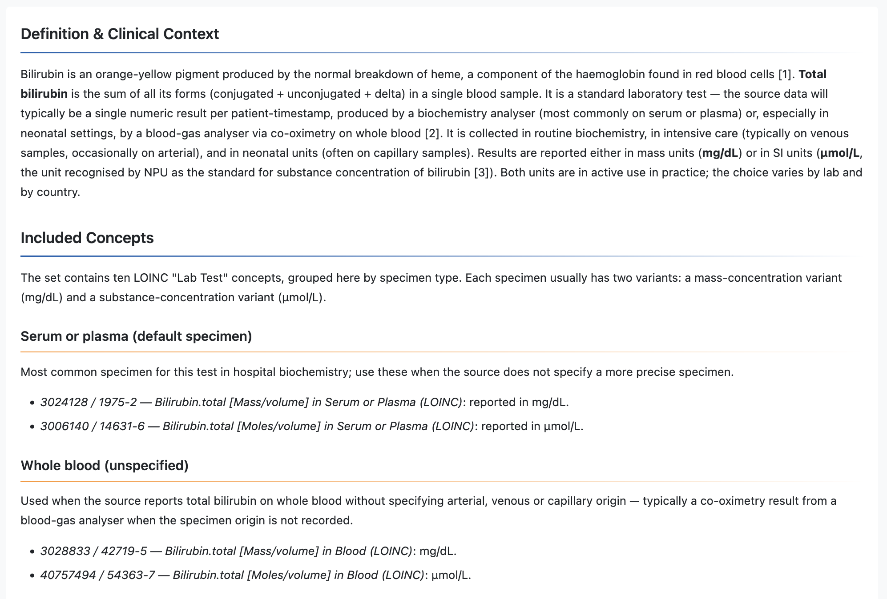
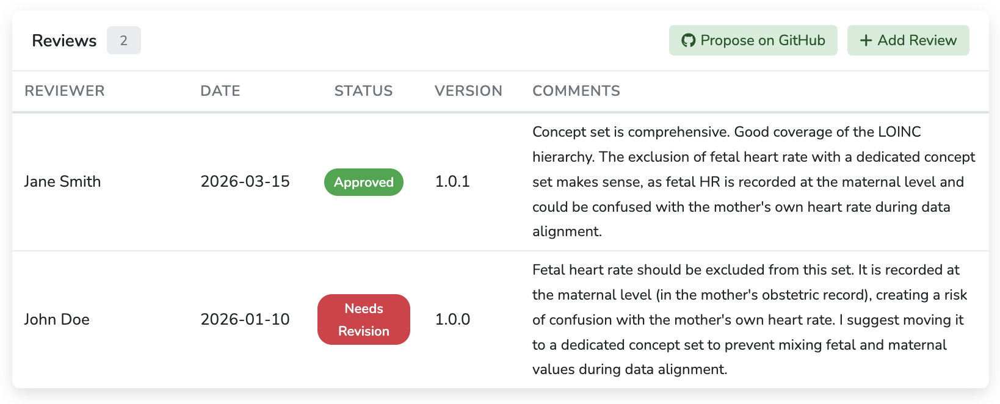
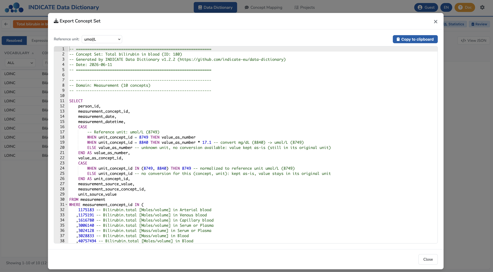

# INDICATE Data Dictionary

[](https://indicate-eu.github.io/data-dictionary/)
[](https://indicate-eu.github.io/data-dictionary/#/documentation)
[](https://indicate-europe.eu/)
[](https://joinup.ec.europa.eu/collection/eupl/eupl-text-eupl-12)



> Clinicians writing a research protocol rarely say _"I need LOINC 1975-2 and 14631-6."_ They say _"I need total bilirubin."_<br />
> Data engineers building an OMOP ETL need the exact concept IDs, descendants, and unit conversions.
>
> The **INDICATE Data Dictionary** sits between those two worlds — a shared workspace where clinical variables are defined *once*, reviewed by experts, versioned, and handed off to data teams as ready-to-use **OHDSI concept sets** with SQL, unit harmonization, and ATLAS-compatible JSON.

> [!NOTE]
> **Version 2** (React + FastAPI, this branch) adds accounts, server-side drafts and automatic pull requests to the static app. The live site above is still **v1** (`legacy/`) until the cutover described in [docs/deployment.md](docs/deployment.md#cutover-v1--v2-on-main). The screenshots below show v1.



---

## Why this exists

The [OHDSI Phenotype Library](https://data.ohdsi.org/PhenotypeLibrary/) provides a governance framework for phenotypes — peer review, semantic versioning, status tracking, expert commentary. **No equivalent exists for concept sets**, even though they are the building blocks *underneath* phenotypes. [ATLAS](https://atlas-demo.ohdsi.org/) lets you build concept sets, but has no review workflow, no version control, and no field for expert guidance.

The INDICATE Data Dictionary fills that gap with an **extension of the OHDSI Concept Set Specification** — fully backward-compatible (JSON in, JSON out, ATLAS-compatible) — plus an app to browse, review, edit, and export concept sets. The content lives as JSON files in a Git repository: every change is a commit, reviewed like code.

## What's in the box

### For clinicians & domain experts

- **Browse by clinical category** — 300+ concept sets across demographics, conditions, vitals, labs, microbiology, ventilation, drugs, procedures, observations. Search in English or French.
- **Every concept set is anchored on a clinical variable** — you enter by the variable's name ("Heart rate", "Total bilirubin in blood"), read the expert commentary explaining what it means in practice, and *then* see the underlying codes, with links to the source vocabularies (SNOMED, LOINC, RxNorm).
- **Concept hierarchy at a glance** — for any concept, an interactive graph shows where it sits in its source vocabulary, so you can check the definition captures the right level.
- **Expert comments** — clinical commentary written by the consortium: subtleties, edge cases, ETL gotchas.
- **Review and propose changes** — submit a review or an edit; it becomes a pull request on the repository, from the browser.
- **Multilingual** — English and French today; the format takes any number of languages.


*Concept set detail view. The underlying OMOP concepts are listed on the left; selecting one shows its details on the right, including an interactive **concept hierarchy** graph.*


*Expert commentary: definition, clinical context, and the included concepts grouped by specimen.*

<p align="center"></p>

*Review tab. Each review records the reviewer, date, version, status (Approved, Needs Revision, Pending Review…) and comments: an auditable peer-review history per concept set.*

### For data scientists & OMOP engineers

- **ATLAS interoperability** — concept sets are standard OHDSI JSON: import from ATLAS, edit, export back.
- **Semantic versioning** — every concept set has a version; projects pin the versions they use, so a study cites the exact set it used.
- **Review workflow** — `draft → pending review → approved → needs revision → deprecated`, with reviewer identity (ORCID), dates and comments, stored in the JSON.
- **Expression editor** — search the OMOP vocabularies, add concepts with descendants or mapped concepts, see the resolved list live, and optimize the expression.
- **Auto-generated SQL** — pick a concept set and a reference unit, get an OMOP query on the right CDM table with per-concept unit conversion (`CASE WHEN unit_concept_id = … THEN value_as_number * factor`).
- **Unit harmonization** — recommended units for laboratory concepts and an explicit conversion table.
- **Projects** — concept sets grouped by study, pinned to versions, exported as CSV.
- **Mapping coverage** — import a mapping (source_to_concept_map, SSSOM, Usagi, Linkr…) and see how much of each project it covers; plus multilingual mapping recommendations.
- **Dev tools** — SQL editor on the loaded vocabularies and an ERD of the OMOP CDM.


*SQL export for a laboratory concept set: each source unit is converted into the chosen reference unit.*

## Two ways to run it

| | **Static** (GitHub / GitLab Pages) | **Server** (Docker) |
|---|---|---|
| Hosting | free static hosting, no server | `web` (nginx) + `api` (FastAPI) containers |
| Reading | public | public, or login required |
| Contributing | "Propose on GitHub / GitLab" from the browser | accounts (local, GitHub, GitLab, ORCID) and roles; edits saved as drafts, submitted as pull / merge requests automatically, or committed by maintainers |
| OMOP vocabulary | each user imports ATHENA files into their browser (DuckDB-WASM, nothing leaves the machine) | imported once on the server, shared |

Both read the same content files from the same repository.

## Quick start

Needs Node 22, Python 3.12 and [uv](https://docs.astral.sh/uv/) (server), git.

```bash
git clone https://github.com/indicate-eu/data-dictionary.git
cd data-dictionary
git checkout v2
npm install
python3 build.py              # builds the static catalogue (legacy/data.json)
```

**Static mode** (no server, like the published site):

```bash
npm run dev:client            # http://localhost:3000
```

**Server mode** (web + API, with login):

```bash
cd apps/api && uv venv --python 3.12 && uv pip install -e ".[dev]" && cp .env.example .env && cd ../..
# in apps/api/.env: DD_DEBUG=true for local development
npm run dev:all               # web on :3000, API on :8000; the first visit creates the admin account
```

In development the API reads the content of the repository it runs from.

**Docker** (server mode, as deployed):

```bash
export DD_SECRET_KEY=$(python3 -c "import secrets; print(secrets.token_urlsafe(48))")
docker compose -f docker/docker-compose.yml up -d --build    # http://localhost:3000
```

The API clones the content repository (`DD_CONTENT_REPO_URL`, INDICATE's by default) on first start. Variables, reverse proxy, PostgreSQL, backups and static hosting: [docs/deployment.md](docs/deployment.md).

### Editing content by hand

Concept sets are JSON files (`concept_sets/{id}.json`); edit them and open a pull request. After changing an `expression`, regenerate its resolved list and commit it (CI never resolves):

```bash
python3 resolve.py --vocab /path/to/athena --id 10   # ATHENA CSV / Parquet folder or .duckdb
```

Projects pin concept set versions through `concept_sets_versions.json`; when you bump a version by hand, follow the two-commit flow in [docs/build-pipeline.md](docs/build-pipeline.md). The server mode does it for you.

### Fork it for your own dictionary

Any group (oncology, cardiology, primary care, a single-center registry…) can copy this repository, set `config.json` and its branding (or use the Branding settings and the first-run wizard), run `python3 reset.py`, and publish its own governed dictionary as a static site or a server. See [FORKING.md](FORKING.md).

## How it compares

<div align="center">

|                                     | ATLAS (OHDSI) | **INDICATE**        |
|:------------------------------------|:---------:|:-------------------:|
| Concept set creation & editing      | ✅ | ✅ |
| Live OMOP concept count (usage)     | ✅ | — |
| Peer review workflow                | — | ✅ |
| Semantic versioning                 | — | ✅ |
| Expert guidance                     | — | ✅ |
| Open source                         | ✅ | ✅ |
| Deployment                          | Institutional (WebAPI) | **Static site or Docker, Git-native** |

</div>

This is **complementary** to ATLAS: concept sets authored here go back into ATLAS for cohort building — what we add is the governance layer around them.

## Tech stack

- **Web** (`apps/web`): React 19, Vite, TypeScript, Tailwind CSS and shadcn/ui, zustand, i18next; [DuckDB-WASM](https://duckdb.org/docs/api/wasm/overview) runs the OMOP vocabulary in the browser in static mode; Monaco for SQL, vis-network for graphs.
- **API** (`apps/api`): FastAPI, SQLAlchemy (SQLite or PostgreSQL), Alembic, DuckDB on Parquet for the vocabulary, git for the content repository.
- **Format** (`packages/dictionary-format`): JSON Schemas and a byte-exact serializer, in TypeScript and Python, tested against every content file.
- **Scripts**: `build.py`, `resolve.py`, `snapshot.py` (Python, standard library + DuckDB for `resolve.py`).

The architecture is adapted from [Linkr](https://framagit.org/interhop/linkr/linkr). Details: [docs/architecture.md](docs/architecture.md).

## The INDICATE project

The [INDICATE consortium](https://indicate-europe.eu/), funded by the European Union's Digital Europe Programme (grant 101167778), is building federated infrastructure for standardized ICU data across **15 data providers in 12 European countries**, with **6 clinical use cases**. The Data Dictionary is the common variable layer underneath: a consensus-built set of **300+ concept sets** across 9 clinical categories, built on OMOP CDM with SNOMED, LOINC, RxNorm, and UCUM.

## Repository layout

```
concept_sets/                # Concept set definitions (OHDSI format + INDICATE metadata), one JSON per set
concept_sets_resolved/       # Resolved concept sets (descendants + mapped, generated by resolve.py or the app)
projects/                    # Projects, each pinning concept sets to versions
units/                       # Recommended units + unit conversion table
mapping_recommendations/     # Multilingual ETL mapping guidance
concept_sets_versions.json   # Index { id: { version: commit_sha } } of published versions
config.json                  # The instance: name, languages, repository, organization, branding, access
apps/web/                    # v2 web app (static and server modes)
apps/api/                    # v2 API
packages/dictionary-format/  # Content schemas and serializer (TS + Python)
docker/                      # Dockerfiles and docker-compose.yml
legacy/                      # v1 static SPA, the live site until the cutover
docs/                        # Developer documentation (architecture, formats, deployment, plans)
build.py, resolve.py, snapshot.py, reset.py, update_from_upstream.py
AGENTS.md                    # Entry point for coding agents (CLAUDE.md imports it)
FORKING.md                   # Running your own dictionary
```

## Documentation

- Users: the app's **Documentation** page (English and French); [v1 site](https://indicate-eu.github.io/data-dictionary/#/documentation).
- Deployment: [docs/deployment.md](docs/deployment.md). Forking: [FORKING.md](FORKING.md).
- Developers and agents: [AGENTS.md](AGENTS.md) and [docs/](docs/).

## License

[EUPL-1.2](LICENSE) — European Union Public Licence. Free to use, modify, and redistribute, including in commercial settings, under the same license.

## Acknowledgments

Funded by the **European Union's Digital Europe Programme** under grant agreement **101167778**.
Developed with clinicians, data scientists, and interoperability experts from 15 institutions across 12 countries.
